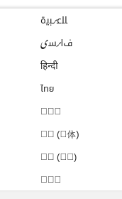

# Deferred font coverage / fallback observation

**Status: P1 follow-up, deferred by the maintainer; not blocking Gate A.**
Reported during the guided Scholar rerun on 2026-10-13. The maintainer says the
flow otherwise seems OK and explicitly requests documentation rather than a fix
now. No font packages or browser/font configuration were changed.

## Observation

Several entries in the language list render square missing-glyph placeholders.
Some neighboring language names render legibly. The narrow screenshot below
was supplied by the maintainer during the Scholar test and contains only the
affected menu; it is retained as relevant issue evidence, not a desktop capture.

The exact selected font, missing code points and menu route were not recorded.
The image establishes incomplete glyph rendering; it does **not** establish
whether the cause is missing system font coverage, fallback selection, site
styling, or an engine defect. No causal investigation was performed in this run.

Environment: stock WPE `2.54.1-2`, Mesa `1:26.2.4-1`, niri `26.04-1`,
native Wayland, explicit ephemeral session/default browser identity, scale 1.
Application C source SHA256:
`6bf147f1390eef2881a8180f418236e5056373c336e081f71f20cb880995bce2`.
Related session: `runs/user-scholar-20261013-repeat.*`.

## Later investigation

Reproduce the language list and record its route, exact affected text/code
points and CSS font declarations. Check installed font coverage and fallback
for those characters, then compare equivalent local text and the site in WPE.
Identify the actual rendered font where possible; a declared CSS family alone
is insufficient. Choose any font-package or browser-default change from that
evidence, and verify previously working text, local MathML and scaling afterward.

This belongs with the architecture's appearance/font/text-rendering follow-up,
not a change to the engine or an authorization to start M2. Multi-monitor and
fractional scaling remain untested.
